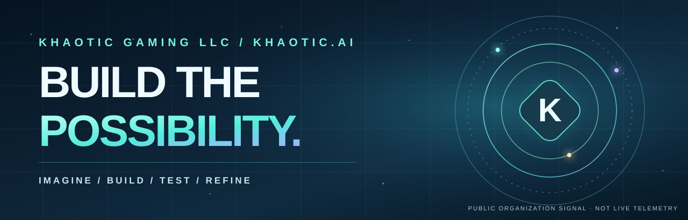

  

<h1 align="center">Welcome to Khaotic.AI</h1>

<strong>Creative technology · Practical AI literacy · Original research · Immersive worlds</strong>

Khaotic Gaming LLC explores the intersection of engineering, AI, interactive experiences and experimental computational systems. This is our public organization gateway—not a release of our private infrastructure or source.

  <a href="https://k-haotic.github.io/K-haotic/organization/">🌐 Enter the Organization</a>
  &nbsp; · &nbsp;
  <a href="https://k-haotic.github.io/K-haotic/ai-systems-circuit/">✦ Learn AI</a>
  &nbsp; · &nbsp;
  <a href="https://k-haotic.github.io/K-haotic/">◈ Explore LEVI Research</a>

---

### Choose your doorway

| Learn AI | Explore the Open Lab | Build with Khaotic |
| :-- | :-- | :-- |
| **AI for Dummies (Tutor) — AI Literacy Training.** Eight free lessons, three practical activities, and an optional Learning Passport. | **LEVI and Recursive Physics.** Published research notes, experiments, measured limits and open questions. | **Khaotic.AI.** Creative technology, gaming, connected experiences and collaboration. |
| [Start the free classroom →](https://k-haotic.github.io/K-haotic/ai-systems-circuit/learn/) | [Explore the public lab →](https://k-haotic.github.io/K-haotic/) | [Visit the organization front door →](https://k-haotic.github.io/K-haotic/organization/) |

### Learning that grows with the community

Anyone can start learning. Future community levels—from Explorer and Follower to Member, Contributor and separately approved Research Partner—are **proposed**, not an active follower-based entitlement system. Learning progress, social follows and account connections do not grant private repository or device access.

### Our publication boundary

**Public:** General AI literacy, published research context, demonstrations, and source-backed claims with known limits.

**Private:** Proprietary Recursive Physics implementation, unpublished material, credentials, internal services and authorized research collaboration. These are not exposed or automatically granted through this profile.

### Find us and say hello

- **Public organization home:** [Khaotic.AI — Build the Possibility](https://k-haotic.github.io/K-haotic/organization/)
- **Founder:** [Mr Khaotic / K-haotic](https://github.com/K-haotic)
- **Website:** [khaotic.ai](https://khaotic.ai/)
- **Contact:** [admin@khaotic.ai](mailto:admin@khaotic.ai?subject=Khaotic%20Collaboration)

Independent Khaotic educational material; not affiliated with the publisher of the “For Dummies” book series. Site/course availability and private authorization are separate.
